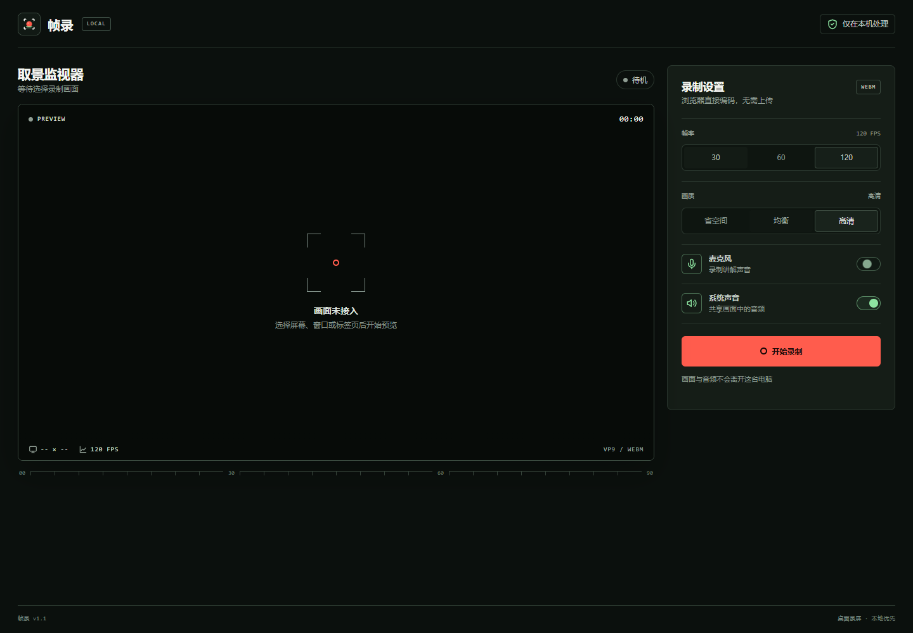

# 帧录

帧录是一个本地优先的轻量屏幕录制工具。它使用浏览器原生
`getDisplayMedia` 和 `MediaRecorder` API，录制内容不会上传到服务器。



## 开始使用

前置条件：安装 Node.js 18 或更高版本。

1. 双击 `start.cmd`。
2. 在浏览器中选择屏幕、窗口或标签页。
3. 选择音频与画质设置。
4. 开始录制。
5. 停止后预览并下载 WebM 文件。

启动器会打开 `http://localhost:4173`。如果端口已占用，启动器会自动使用下一个可用端口。

也可以在终端运行：

```powershell
node server.mjs
```

## 功能

- 录制整个屏幕、应用窗口或浏览器标签页
- 可选麦克风音频和系统声音
- 30 FPS、60 FPS 或 120 FPS
- 省空间、均衡、高清三档画质
- 暂停与继续
- 实时计时和画面预览
- 完成后预览、重新录制和下载
- 快捷键：`Alt+R` 开始或停止，`Alt+P` 暂停或继续

## 浏览器与格式

建议使用最新版 Chrome 或 Edge。

- Safari 不支持本工具依赖的完整录屏流程。
- 系统声音是否可录取决于操作系统、浏览器和所选共享源。
- 120 FPS 是请求上限。浏览器与显示器可能自动选择更低帧率。
- 浏览器直接输出 WebM。需要 MP4 时，可用 HandBrake、FFmpeg 或其他转换工具处理。

## 隐私

- 本地启动器只监听 `127.0.0.1`。
- 录制内容只保存在浏览器内存中。
- 页面没有上传接口，也不会加载外部字体、脚本或统计服务。

## 文件结构

```text
screen-recorder/
├─ app.js                  # 录制交互与媒体流处理
├─ index.html              # 主界面
├─ styles.css              # 响应式界面样式
├─ icon.svg                # 应用图标
├─ icon-512.png            # 透明背景图标
├─ icon.ico                # Windows 多尺寸图标
├─ server.mjs              # 零依赖本地静态服务器
├─ start.cmd               # Windows 启动入口
├─ src/recorder-core.js    # 可测试的纯逻辑
└─ test/                   # Node.js 单元测试
```

## 验证

```powershell
node --test
node --check app.js
node --check server.mjs
```

## 开源参考

以下项目用于核对浏览器录屏流程和功能范围：

- [Modern Screen Recorder Web App](https://github.com/girishlade111/Modern-Screen-Recorder-Web-App)
- [Simple Screen Recorder](https://github.com/Pravinakajerry/Simple-Screen-Recorder)
- [Screen Recorder Web App](https://github.com/AbdulRehmanRaza03/Screen-Recorder-Web-App)

本项目为独立实现，未复制这些项目的源代码。
